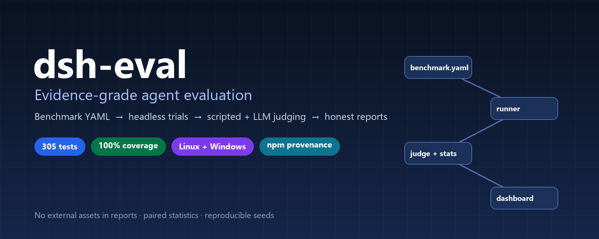
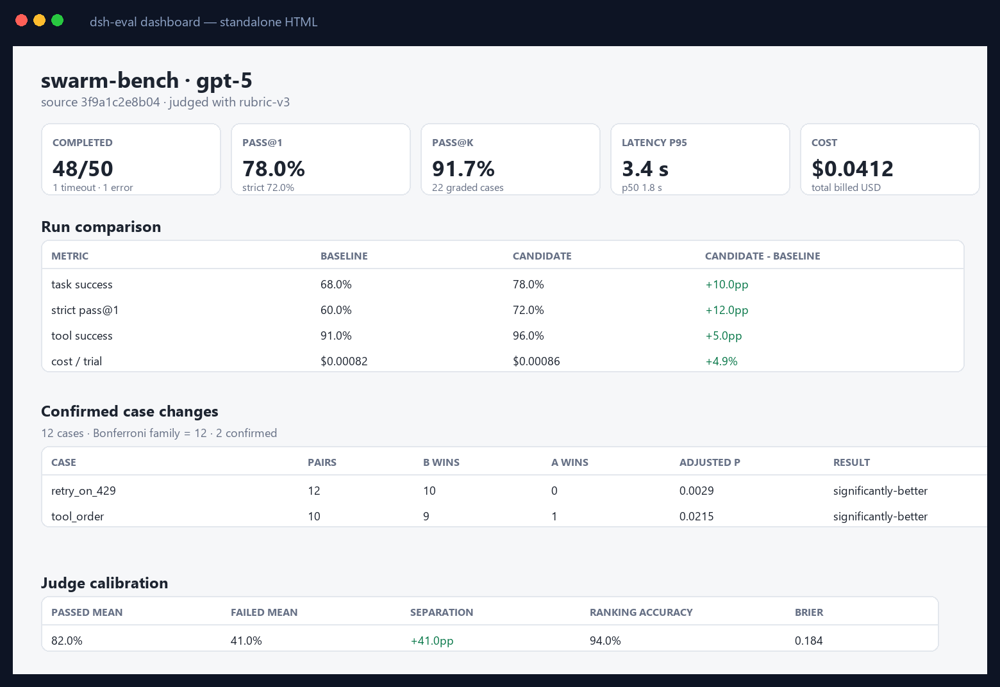
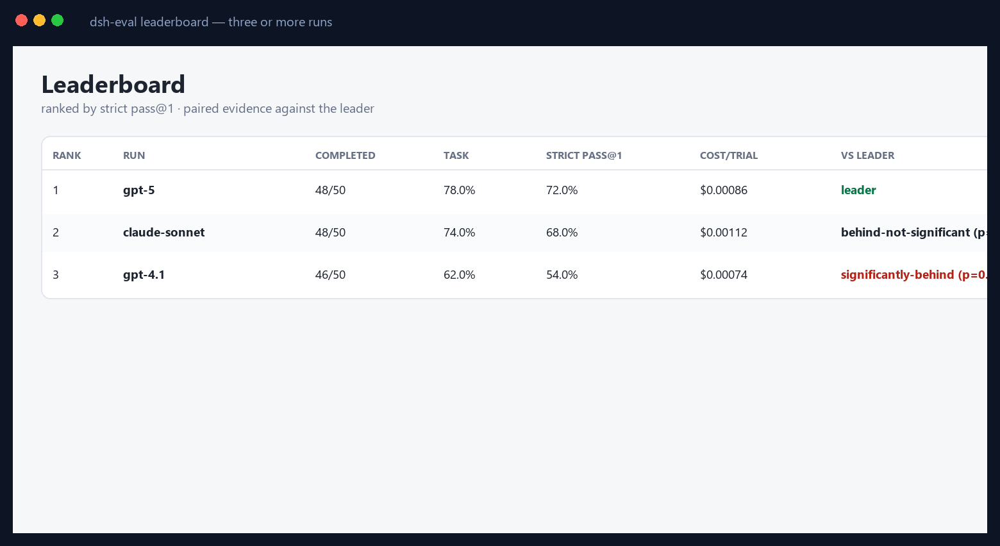
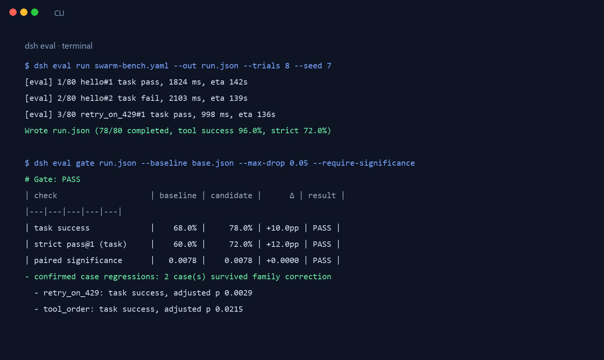

# dsh-eval

[English](README.md) | 中文

**面向 [deepseek-harness](https://github.com/deepseek-ai/deepseek-harness) 的 Agent 评测平台。**

[](https://www.npmjs.com/package/dsh-eval)
[](LICENSE)



对 headless `dsh` profile 跑 benchmark，把持久化的 session 日志收获成 trace，折叠出自动指标，评分任务成功与工具选择，并把 run 输出为报告或做对比 —— 一份 `benchmark.yaml` 进，一份 JSON run + Markdown 报告出。

> dsh 生态已有可观测与调试工具（`dsh-trace`、`dsh-tps`、`dsh-context-doctor`）。dsh-eval 补的是缺的那一格：**评测平台**。

## 能力

- `dsh eval run benchmark.yaml` —— 每个 case × trial 编排一个 headless `dsh` 子进程
- 从持久化 session 日志收获 trace（模型看到的每个字节都能从日志重建）
- 自动指标：任务成功、工具成功、工具选择准确率、steps、token、延迟、成本、重试、无效工具调用、上下文用量
- 脚本化评分：工具约束（`tool`/`tools`/`toolAnyOf`/`toolRegex`/`toolNot`）、检查命令（`check`/`checkArgv`/`checkShell`），以及无需 LLM judge 的 `answerRegex` 最终答案检查
- LLM judge：最终答案得分与幻觉标记，支持金标答案，判官失败显式可见
- 子 agent trace 合并：子 session 日志折叠进 trial 指标
- 配对 A/B：同 case 的胜/负/平统计
- 配对推断：带功效/最小可检出样本量下限的精确符号检验，每个均值差给出固定种子 bootstrap 区间，并对报告内的整个推断族做 Bonferroni 校正
- 可靠性：从 trial 直接推导每个 case 的 pass@1 / pass@k / pass^k、不稳定 case 列表、最难 case 排名，以及把超时/失败 trial 保留在分母中的严格通过率
- 精度：单 run 通过率（含把所有 trial 计入分母的严格 pass@1）的固定种子 bootstrap 区间，以及延迟 p50/p95，让小样本 run 坦白展示不确定性
- 一致性：判官与脚本评分的一致率和 Cohen's kappa，可用真实检查校验代理判官是否可信
- 并发 trial：`concurrency` / `--concurrency` 让多个 case × trial 同时跑，结果顺序不变
- keyless 回放：有 key 时录一次，CI 里从录制日志复现
- 跨 harness 导入：`dsh eval import codex|claude-code <log> --out run.json`
- `dsh eval report run.json` —— 带每个 trial 评分、合并比率、可靠性与精度区块的 Markdown 报告；`--brief` 输出紧凑终端摘要，`--json` 输出全部派生区块的结构化数据
- `dsh eval export run.json [--out trials.csv]` —— 逐 trial 的扁平 CSV，便于表格与 notebook 分析，公式注入与引号均已安全转义
- `dsh eval dashboard a.json [b.json ...] --out report.html [--metric strictPassAt1]` —— 独立 HTML 仪表盘：单个 run、双 run 对比，或三个及以上 run 的排行榜（`--metric` 仅用于排行榜，含对领先者的配对判定），自动适配深色模式，无外部依赖
- `dsh eval validate benchmark.yaml [--json]` —— 运行前预检 benchmark，在花 token 前提示证据薄弱环节
- `dsh eval provenance run.json benchmark.yaml [--json]` —— 校验 run 中保存的 benchmark 摘要与当前 YAML、提示词、工作区和回放输入是否一致；缺失或不一致时退出码为 1
- `dsh eval leaderboard a.json b.json c.json` —— 按任务成功率给任意数量的 run 排名，显示与领先者的差距，并给出对领先者的 Bonferroni 校正配对判定；`--metric strictPassAt1` 改用含错误/超时的严格通过率排序，`--json` 便于自动化消费
- `dsh eval gate candidate.json --baseline base.json --max-drop 0.05 [--max-segment-drop 0.02] [--require-significance] [--json]` —— CI 质量与资源预算门禁；显著性模式只在统计确认回退时失败；`--max-segment-drop` 可捕获整体持平但集中在某个 case tag 上的退化
- `dsh eval compare v1.json v2.json` —— 带符号的 `B - A` 对比表和配对推断；`--json` 输出结构化数据
- `dsh eval rejudge run.json --out rejudged.json` —— 用新判官模型或 rubric 离线重评分，无需重跑 agent；记录的 SHA-256 trace 摘要可拒绝被篡改的日志
- `dsh eval reproduce run.json benchmark.yaml --out replay.json` —— 按基线记录的 seed 与覆盖项复现运行，benchmark 摘要变化直接拒绝，并打印前后完成数与成功率；`--json` 输出机器可读对比结果
- `dsh eval segments base.json candidate.json` —— 按 case tag 对齐两次 run，输出任务成功率与判官分数的差值；支持 `--json` 与 `--out`

## 为什么选 dsh-eval，而不是临时脚本

| 关注点 | 临时脚本 | dsh-eval |
|---|---|---|
| 模型超时 | 从平均值里悄悄丢掉 | 计入严格 pass@1 |
| "B 更好" | 一个汇总数字 | 配对符号检验、功效下限、bootstrap 区间 |
| 比较很多 case | 容易挑 cherry-pick | 逐 case Bonferroni 校正 |
| 配置不同却同名报告 | 很容易误标 | 摘要覆盖 YAML、提示词、工作区与 CLI 覆盖项 |
| CI 回退检查 | 脆弱的固定阈值 | 硬资源预算 + 可选显著性门禁 |
| 判官质量 | 默认可信 | 一致率、kappa、区分度、排序准确率、Brier |
| 分享结果 | 终端截图 | 自包含 HTML、JSON、CSV |

## 实际效果

### 独立 HTML 仪表盘



`dsh eval dashboard a.json b.json --out report.html` 生成单个自包含文件：无 CDN、无运行时请求、无外部 CSS。双 run 视图按 `caseId` 配对 trial，展示 bootstrap 区间，并且只突出通过 Bonferroni 校正的 case 变化。

### 多 run 排行榜



三个及以上 run 时，同一个仪表盘变成排行榜。`--metric strictPassAt1` 按含错误/超时的严格通过率排序，避免模型靠"难题直接放弃"在幸存者平均值上获胜；最后一列给出对领先者的族校正配对判定。

### CI 门禁与终端输出



进度行对控制字符安全且有长度上限，`dsh eval gate` 把对比变成带硬资源预算的 PASS/FAIL 构建步骤。显著性模式下，确认的 case 回退也会让门禁失败，绿灯构建不会同时宣称已知回退。

## 状态

`dsh-eval@0.5.23` · 450 个测试 · `src` 语句/分支/函数/行覆盖率 100% · 类型检查干净 · Linux 与 Windows 双平台 CI。

`0.3.1` 起可安装：`0.3.0` 的 tarball 漏掉了入口 import 的运行时模块，导致每次安装都报 `ERR_MODULE_NOT_FOUND`。详见 [CHANGELOG.md](CHANGELOG.md)。

## 快速开始

直接安装：

```sh
pnpm add dsh-eval
dsh plugin --profile eval add dsh-eval
```

npm 包对齐官方 `@deepseek-ai/*` 发布版（`0.1.0-rc.6` peer），本仓库的 workspace 也解析同一批版本，所以从 clone 构建出来和用户装到的东西一致，不需要链接 harness 检出：

```sh
git clone https://github.com/hccccc01333/dsh-eval.git
cd dsh-eval
pnpm install
pnpm --filter dsh-eval build
pnpm --filter dsh-eval test
```

跑 benchmark 需要一个 `dsh` 启动器；`pnpm test` 不需要（测试套件 keyless，用 fake `dsh` 与录制的 session 日志夹具）：

```sh
dsh plugin --profile eval add dsh-eval
cp examples/minimal-benchmark.yaml benchmark.yaml  # 自包含，无需夹具文件
dsh eval validate benchmark.yaml
dsh eval run benchmark.yaml --out run-v1.json
dsh eval report run-v1.json --brief
dsh eval run benchmark.yaml --out run-v2.json
dsh eval compare run-v1.json run-v2.json
dsh eval import codex ~/.codex/sessions/.../session.jsonl --out codex-run.json
```

## Benchmark 文档

```yaml
name: quickstart
model: deepseek-v4
cases:
  - id: hello
    prompt: Reply with exactly "pong".
    expected:
      answerRegex: '^pong$'
pricing:
  deepseek-v4:
    inputUsdPerMTokens: 0.27
    cacheReadUsdPerMTokens: 0.07
    cacheWriteUsdPerMTokens: 0.27
    outputUsdPerMTokens: 1.10
```

该示例自包含：`answerRegex` 直接评分最终回复，不需要工作区或 check 脚本。可直接复制的文件见 [examples/minimal-benchmark.yaml](examples/minimal-benchmark.yaml)。每个 trial 在独立的临时工作区、隔离的 `DSH_HOME` 与非交互权限下运行，主 session 日志即该 trial 的 trace。脚本化评分（`checkArgv`/`checkShell`、工具匹配）、`workspace`、`trials`、`seed` 等字段见 [packages/eval/README.zh.md](packages/eval/README.zh.md)。

## 指标

| 指标 | 来源 |
|---|---|
| 任务成功 | `expected.check` 退出码 0 |
| 工具成功 / 成功率 | session 日志中的 tool result |
| 工具选择准确率 | `expected.tool` 子串匹配 |
| steps / turns | session 日志的 turn 与工具事件 |
| token / 上下文用量 | 互不重叠的 token 桶 + 计费上下文 |
| 延迟 | `llmMs` / `toolMs` / `ttftMs` / `latencyMs` |
| 成本 | 按模型定价表（`pricing`） |
| 重试 | `llm/retry` 事件 |
| 无效工具调用 | 携带内部失败身份的 tool result |
| 最终答案得分 / 幻觉 | `judge` 配置给出的 LLM 评审裁决 |

benchmark 的 SHA-256 覆盖 YAML 源文本以及所有解析后的输入:prompt 文件、
workspace 目录与 replay 日志。摘要写入每个 run,并在 `report`、`validate` 和
HTML 仪表盘中展示,因此 fixture 改动不会悄悄改变结果含义。CLI 选项覆盖另行
记录在 run 的选项字段中。

## CLI

| 命令 | 作用 |
|---|---|
| `dsh eval run benchmark.yaml --out run.json [--trials N] [--concurrency N] [--seed N]` | 执行 benchmark，向 stderr 输出进度并写出 JSON run；覆盖项会写入 provenance |
| `dsh eval report run.json` | 把 run 渲染为 Markdown |
| `dsh eval report run.json --brief` | 省略逐 trial 表格，输出紧凑终端摘要 |
| `dsh eval report run.json --json` | 输出 run 与全部派生区块的 JSON |
| `dsh eval report run.json [--out report.md]` | 把任意报告变体写入文件，而非输出到终端 |
| `dsh eval export run.json [--out trials.csv]` | 把逐 trial 数据导出为安全转义的 CSV |
| `dsh eval dashboard a.json [b.json ...] --out report.html [--metric strictPassAt1]` | 写出独立 HTML 仪表盘或多 run 排行榜（`--metric` 仅用于排行榜） |
| `dsh eval validate benchmark.yaml [--json] [--out file]` | 预检 benchmark 并给出证据质量警告 |
| `dsh eval provenance run.json benchmark.yaml [--json] [--out file]` | 校验 run 的 benchmark SHA-256；不一致时退出码为 1 |
| `dsh eval leaderboard a.json b.json ... [--metric taskSuccess\|strictPassAt1] [--json] [--out file]` | 按池化成功率或含错误的严格通过率排名 |
| `dsh eval gate candidate.json --baseline base.json [--max-drop 0.05] [--max-segment-drop 0.02] [--json] [--out file]` | 回退或超限时让 CI 失败；`--max-drop` 是容许的回退比例（默认 `0` = 任何回退都失败），`--max-segment-drop` 同时对双方共有的 case tag 设限，`--json` 输出机器可读判定 |
| `dsh eval compare base.json candidate.json [--json] [--out file]` | 对比两个 run，给出差值与配对推断 |
| `dsh eval rejudge run.json --out rejudged.json` | 离线重评分已保存的 trace，写入新报告 |
| `dsh eval reproduce run.json benchmark.yaml [--out replay.json] [--json]` | 按基线设置复现；benchmark 摘要变化时拒绝 |
| `dsh eval segments base.json candidate.json [--json] [--out file]` | 按 case tag 对比两个 run 的带符号差值 |
| `dsh eval import codex\|claude-code log.jsonl --out run.json` | 把外部 session 日志导入为单 trial run |

所有只读渲染命令(`report`、`compare`、`validate`、`leaderboard`、`gate`、
`export`)都支持 `--out <file>`,会自动创建父目录;省略时输出到终端。

`dsh eval run` 还支持 `--trials`、`--concurrency`、`--dsh`、`--profile`、`--quiet`、`--allow-external-paths` 覆盖 benchmark 文档；`dsh eval validate` 也接受 `--allow-external-paths`，`dsh eval import` 支持 `--case-id`。第三方 benchmark 默认限制路径范围，只有可信操作者显式传入 `--allow-external-paths` 才放行。

## 路线图

- 按实验组（arm）的配对排行榜
- run 报告与对比的 Web UI

以上均为待办想法；已完成的工作见 [CHANGELOG.md](CHANGELOG.md)，按价值排序的
缺口清单见 [ROADMAP.md](ROADMAP.md)。

## 仓库结构

```
packages/eval/    插件 bundle + CLI 应用 + 测试
scripts/          harness-closure.mjs —— 可选的本地 harness workspace 闭包
```

回放（`replay.dir`）需要源码构建的 `dsh`；其余功能用发布版 peer 即可。

## 发版

改 `packages/eval/package.json` 的 `version` 并在 CHANGELOG 里加一节，然后推同名 tag：

```sh
git tag v0.5.23 && git push origin v0.5.23
```

`.github/workflows/release.yml` 会重跑各道闸门，再通过 **trusted publishing（OIDC）** 带 provenance 发布到 npm，任何机器上都不需要存 token。npm 的 Trusted Publisher 登记（GitHub Actions，workflow 填 `release.yml`）已完成，自 `0.5.0` 起的所有版本均由此发布。账号的第二因子是安全密钥，因此既不存储也不依赖长期 token。

完整发布清单、Trusted Publisher 的精确字段（仅在换发布账号或仓库时需要重配）
与手动 OIDC 身份检查见 [RELEASE.md](RELEASE.md)。

## 许可

MIT
