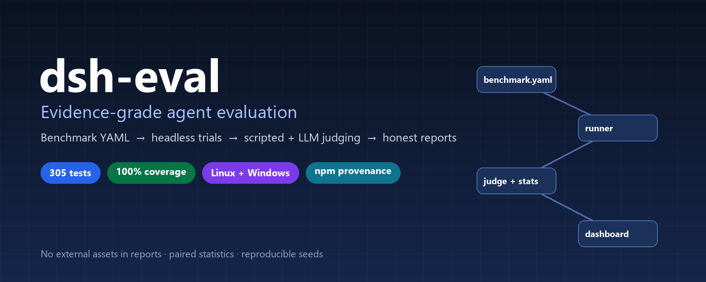
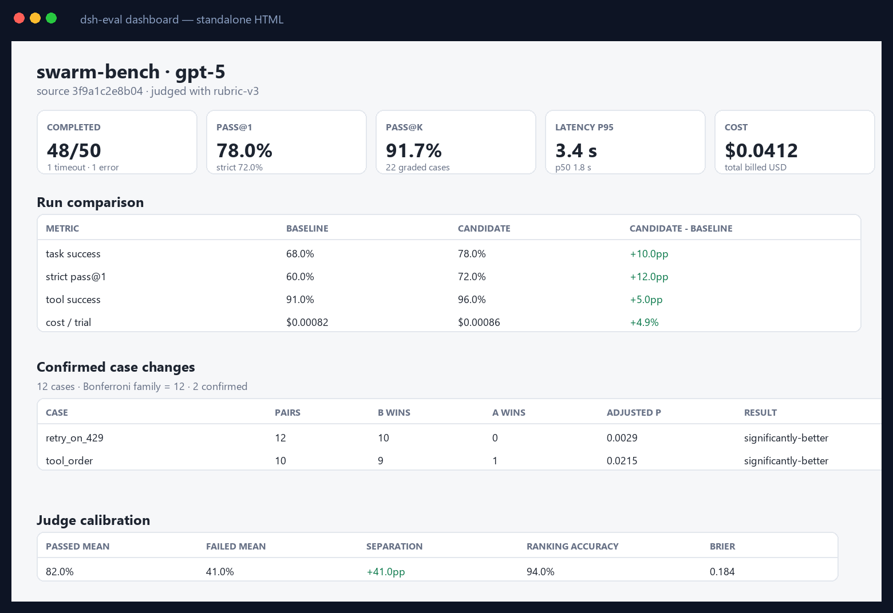
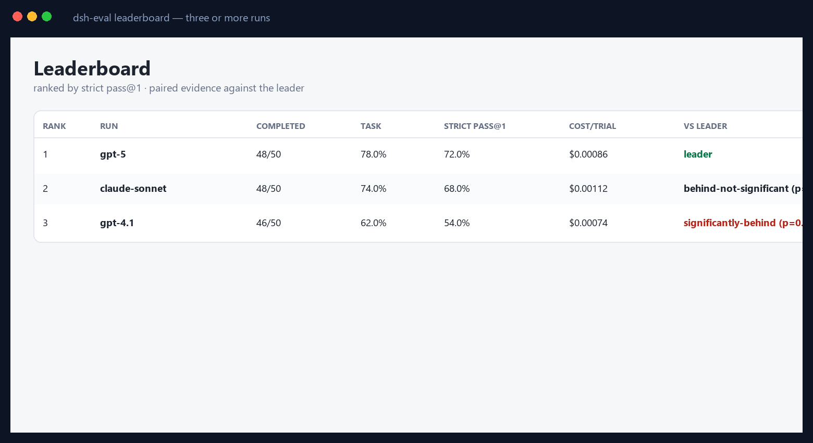
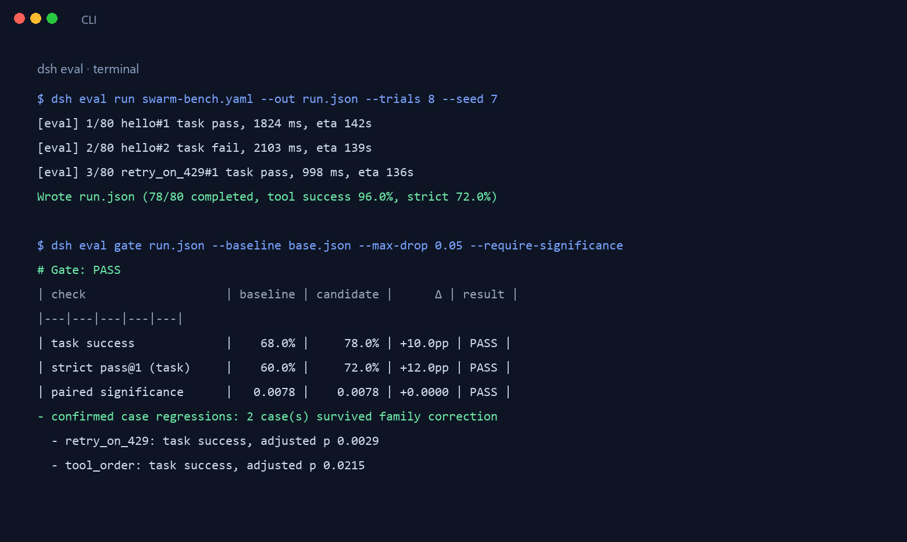

# `dsh-eval`

[English](README.md) | 中文

[](https://www.npmjs.com/package/dsh-eval)
[](https://github.com/hccccc01333/dsh-eval/actions/workflows/ci.yml)
[](LICENSE)



**面向 [deepseek-harness](https://github.com/deepseek-ai/deepseek-harness) 的有证据 Agent 评测。** 一份 `benchmark.yaml` 进，可审计的 JSON、Markdown、CSV 与自包含 HTML 出。

> 没有不确定性、配对证据与来源摘要的准确率数字，只是猜测。dsh-eval 让报告里的每个结论都能追溯到 trial、提示词与 benchmark 文件哈希。

| | |
|---|---|
| **诚实的比率** | 严格 pass@1 把超时和错误留在分母里 |
| **真正的推断** | 配对符号检验、功效下限、bootstrap 区间、Bonferroni 校正 |
| **可审计的 run** | YAML、提示词、工作区与 CLI 覆盖项折叠成一个摘要 |
| **判官质检** | 一致率、kappa、区分度、排序准确率、Brier |
| **面向 CI** | `--require-significance` 门禁 + 硬成本/延迟预算 |
| **零外部资源报告** | 自包含、适配深色模式的 HTML 仪表盘 |

`dsh-eval@0.5.23` · 450 个测试 · `src` 语句/分支/函数/行覆盖率 100% · 类型检查干净 · Linux 与 Windows 双平台 CI。

本包同时是一个 bundle 和一个命令行应用。装进 profile 后即可运行评测：

```sh
dsh plugin --profile eval add dsh-eval
dsh eval run benchmark.yaml --out run-v1.json
dsh eval report run-v1.json --brief
dsh eval run benchmark.yaml --out run-v2.json
dsh eval compare run-v1.json run-v2.json
```

`dsh eval` 是 `--profile eval` 的启动器别名，eval profile 由 `dsh-base` 加本 bundle 组成。每个 trial 以 benchmark 配置的 `dsh` 命令（默认 `dsh`）和配置的 profile（默认 `headless`）启动，带有独立的临时工作区、隔离的 `DSH_HOME`，以及一层强制纯 JSONL 持久化和非交互 workspace-write/never-approval 权限的补丁。收获的主 session 日志即该 trial 的 trace；该 trial `DSH_HOME` 下的子 agent 日志会在指标折叠前合并进来。

trial 之间彼此独立——各自的临时工作区、隔离的 `DSH_HOME`、各自的补丁层——所以 `concurrency` 可以让这么多个 trial 同时跑。无论并发如何交错，run 记录仍按 case、再按 trial 的顺序列出结果；`--concurrency` 可覆盖文档里的值。调高它是用墙钟时间换峰值 CPU、内存与并发的模型额度。

报告会标出异常 trial（延迟、token、步数或重试次数超出该 run 的 1.5×IQR 围栏），并把无法启动的 check 命令作为配置错误而非模型失败呈现——路径写错不再看起来像 0% 的模型成绩。对比页把配对置信区间画成内联森林图；多 run 排行榜会标出成本—质量前沿上被支配的配置（以及无法被更便宜配置替代的配置）。case 可声明 `tags: [hard, ts]`，报告即可按维度拆分结果并按原因归类失败。

run 进行中时，每个完成的 trial 会向 stderr 写一行有长度上限的进度，例如 `[eval] 3/12 golden #1 task pass, 1204 ms`。错误会输出净化后的消息，agent 控制的 case id 无法注入换行。只想要最终 stdout 摘要的脚本可以传 `--quiet`。

## 实际效果



*双 run 仪表盘：配对对比、确认 case 变化与判官校准集中在一个自包含文件里。*



*三个及以上 run 的排行榜，按严格 pass@1 排序并给出对领先者的配对判定。*



*有长度上限的进度行，以及会因确认的逐 case 回退而失败的 CI 门禁。*

## Benchmark 文档

```yaml
name: quickstart
model: deepseek-v4
cases:
  - id: hello
    prompt: Reply with exactly "pong".
    expected:
      answerRegex: '^pong$'
pricing:
  deepseek-v4:
    inputUsdPerMTokens: 0.27
    cacheReadUsdPerMTokens: 0.07
    cacheWriteUsdPerMTokens: 0.27
    outputUsdPerMTokens: 1.10
```

该自包含示例用 `answerRegex` 评分最终回复，不需要工作区或 check 脚本。脚本化评分（`checkArgv`/`checkShell`、工具匹配）与其他字段见下表。

| 字段 | 默认值 | 含义 |
|---|---|---|
| `name` | 必填 | Benchmark 名称，同时写入 run 记录的 `benchmark` 字段。 |
| `model` | 必填 | 用于定价查找与运行报告的模型 id。 |
| `profile` | `headless` | 每个 trial 启动的 dsh profile。 |
| `command` | `[dsh]` | dsh 启动器 argv。 |
| `trials` | `1` | 每个 case 的 trial 数。 |
| `concurrency` | `1` | 同时在跑的 case × trial 数；`1` 表示严格串行。 |
| `timeoutMs` | `600000` | 每个 trial 的超时；到期杀掉直接子进程。 |
| `seed` | `0` | 基础种子：第 n 个 trial 的环境变量为 `DSH_EVAL_SEED=seed+n-1`，该值同时用于报告 bootstrap。harness 需读取该变量才能实现确定性采样。 |
| `cases[].id` | 必填 | 稳定的 case id。 |
| `cases[].prompt` / `cases[].promptFile` | 二选一 | 任务文本，内联或相对 benchmark 文件解析。 |
| `cases[].workspace` | 缺省 | 复制进每个 trial 的工作区树，相对或绝对路径。 |
| `cases[].expected` | 缺省 | 脚本化评分：对记录到的工具调用名匹配 —— `tool`（旧子串）、`tools`（全部列出的子串）、`toolAnyOf`（至少一个）、`toolRegex`（加载时校验）、`toolNot`（都不出现），所有配置同时成立才算命中；`checkArgv`（推荐）、`check`（旧字符串形式，支持引号）或 `checkShell`（显式启用，支持管道/重定向）是 agent 退出后在 trial 工作区运行的命令（退出码 0 = 任务成功）；`answer` 是交给 judge 的金标答案；`answerRegex`（加载时校验）匹配完整的最终 assistant 回复，在没有配置 check 命令时决定 `taskSuccess`，从而无需 judge 也能做确定性评分。正则在带超时的 worker 里运行，因此灾难性正则不会拖垮评测器；同时配置 check 命令与 `answerRegex` 会被 `validate` 警告，因为此时正则会被忽略。填了就必须至少给一个，且最多一种 check 模式。check 进程以独立进程组运行，超时整组终止。 |
| `pricing` | 缺省 | 以模型 id 为键的每百万 token 美元价；未配置的模型报 `costUsd: null`。 |

### Judge

`judge` 开启对最终答案与幻觉的 LLM 评审：

```yaml
judge:
  provider: deepseek
  model: deepseek-v4
  rubric: Prefer correct, concise fixes.
  maxScore: 10
```

| 字段 | 默认值 | 含义 |
|---|---|---|
| `provider` | `deepseek` | judge 调用走的 LLM provider 路由。 |
| `model` | benchmark 的 `model` | judge 使用的模型 id。 |
| `rubric` | 缺省 | 追加到评审 prompt 的任务评分标准。 |
| `maxScore` | `10` | 最终答案得分的上限。 |

case 配了 `expected.answer` 时，judge 会收到该参考答案，并被要求按事实一致性而非表达流畅度打分。judge 调用失败或返回不可用内容时，裁决带 `judgeError`，run 的 `grading.judgeFailures` 会计数；报告会打印该计数，不再让分数悄悄从均值里消失。

judge 用 case 与合并后的 trace 构造一个严格 JSON 的 prompt。回复可解析时，trial 带上裁决字段（`finalAnswerScore`、`hallucination`、`rationale`）；输出不可用或 chat 调用失败只记为空的裁决字段，绝不记为失败的 trial。配置了 judge 但宿主没有暴露 LLM chat seam 时，run 在启动前就失败。

## 指标

指标折叠直接从 session 日志计算自动指标：`turns`、`steps`、`toolCalls`、`toolResults`、`toolSuccess` 与 `toolSuccessRate`、`invalidToolCalls`（携带内部失败身份的 result）、`retries`（`llm/retry`）、互不重叠的 token 桶与合计、计费上下文 token、`llmMs`/`toolMs`/`ttftMs`/`latencyMs`，以及配置了定价后的 `costUsd`。脚本化评分增加每个 trial 的 `taskSuccess`（check 命令退出码 0；未配置 check 时由最终答案的 `answerRegex` 匹配决定）与 `toolSelectionAccuracy`（所有配置的工具约束同时成立），并合并为 run 级比率。`checkArgv` 完全不经过 shell；`checkShell` 仅用于可信 benchmark 文件中需要管道或重定向的场景。卡住的 check 会在 trial 超时时连同整个进程组一起终止，不会拖住整个 run。

trial `DSH_HOME` 下的子 session 日志在折叠前合并进 trial trace，因此委派给子 agent 的工作也计入 steps、token、工具调用、重试与延迟。judge 裁决增加每个 trial 的 `finalAnswerScore` 与 `hallucination`，并合并为 run 级平均分与幻觉率。

## 运行报告

`dsh eval run benchmark.yaml --out run.json` 每次运行写一份 JSON：benchmark 与模型标识、每个 trial 的结果与绝对 trace 路径、聚合指标（计数与耗时为均值，成功率为合并值）、合并后的评分比率。`dsh eval report run.json` 把 run 渲染为 Markdown。trial 工作区与 trace 保留在 run 的 `tempRoot`（私有临时目录）中且不会被删除，run 不再需要时自行清理。

Markdown 报告会为每个评分维度（任务成功、工具选择准确率）追加**可靠性**区块。合并比率无法区分"每个 case 都稳定在 66%"与"两个 case 全过、第三个全挂"；因此区块给出 `pass@1`（trial 级）、`pass@k`（至少一个 trial 成功的 case 比例）、`pass^k`（全部 trial 成功的 case 比例），以及结果不一致的不稳定 case 和按通过率排序的最难 case。报告头部还会给出 trial 覆盖率（完成/总数、未评分、超时数），可靠性区块在"仅已评分"的通过率旁并列 **严格 pass@1**：超时与失败 trial 留在分母里，因此"难题上超时"的模型不会显得比"跑完但答错"的模型更好。这些指标在渲染时从已保存的 trial 现算，旧报告无需重跑就能获得新区块。`dsh eval run` 只要有任何 trial 失败就以非零码退出，而非等到全部失败。

`dsh eval report run.json --brief` 改为输出紧凑的终端摘要：试验覆盖率、每个 trial 的工具/步数/token/成本、任务通过率与 pass@k/pass^k、bootstrap 区间、判官失败数。省略逐 trial 表格，百次 run 也能一屏看完。

`dsh eval dashboard a.json [b.json ...] --out report.html` 写出独立的 HTML 视图：覆盖率、pass@1/pass@k、延迟 p95 与成本的摘要卡片，以及可靠性、精度、判官/脚本一致性和逐 trial 表格。无外部 CSS、字体或脚本，自动跟随系统亮/暗主题；benchmark id、case id 与错误字符串都做 HTML 转义，agent 产生的错误信息无法向页面注入标记。提供第二个 run 时会追加对比表，数据与 `dsh eval compare` 完全一致，包括带符号的 `B − A` 差值和 Bonferroni 校正后的配对推断行。三个及以上 run 则生成排行榜页面，排名规则与 `dsh eval leaderboard` 一致，包含任务/strict/工具/判官比率及与领先者的差距。所有路径共用同一份转义过的自包含样式。

完整报告里，可靠性区块之后是**精度**区块：用 run 的 `seed` 对已评分 trial 的 0/1 结果做 bootstrap（默认 2000 次固定种子重采样），给出任务/工具通过率的 95% 百分位区间与样本数 `n=`。只有一个 trial 时只报通过率、不报区间 —— 单个观测无法重采样出不确定性。区块同时给出 trial 延迟的 p50/p95，让三 trial 的冒烟测试看起来就是薄弱证据，而不是一个看似精确的百分比。

**判官 / 脚本一致性**区块把脚本的 `taskSuccess` 与判官的"未检出幻觉"结论配对（仅统计两者都存在的 trial），给出观察一致率与 Cohen's kappa。kappa 扣除了由两边边缘分布带来的偶然一致 —— 否则一个"什么都判通过"的判官，在脚本检查也全部通过时会显得很准。判官输出不可用或没有检查的 trial 会被排除；没有任何配对时该区块不渲染。`--brief` 输出同样包含一行该指标。

## 对比

`dsh eval compare run-v1.json run-v2.json` 把两个 run 渲染成 Markdown 表：benchmark/模型标识、完成的 trial 数、steps、工具/任务/工具选择成功率、两个评分维度的 pass@k 与 pass^k、无效调用、重试、token、成本与延迟，并给出带符号的 `B - A` 差值。当两个 run 完成的 case × trial 键完全一致时，表尾追加配对统计：trial 数、按第一个可用指标（任务成功、工具选择准确率、最终答案得分）的胜/负/平，以及 steps、token、judge 得分的 `B - A` 均值差。每个 run 的 `seed` 既是配对的可追溯出处，也注入到每个 trial 的 `DSH_EVAL_SEED`；是否确定性仍取决于 harness 是否读取该变量。

配对样本量小、差值不服从正态，所以配对区块除了点估计还给出推断：对主指标的不一致对做**精确双侧符号检验**（同分的对按要求剔除），并在每个均值差旁给出**固定种子 bootstrap 区间**。不对差值分布的形状做任何假设，PRNG 种子固定，因此同一对报告重跑 `compare` 输出逐字节一致。符号检验的 p 值与输出的每个区间构成一个推断族，用 **Bonferroni** 在族错误率 `alpha = 0.05` 下一并校正：p 值所在行标注其乘上的族大小，每个区间放宽到 `1 - 0.05/k` 置信度（例如 p 值与三个区间同时存在时为 98.8%）。符号检验仍需要不一致对才能给出结论：全部同分的 run 报 `p = 1`。新增的**统计功效行**会说明当前样本在最理想结果下能达到的最佳校正 p 值；若根本达不到 `alpha`，则给出所需的最少不一致对数（单项比较为 6，常见四项比较为 8），避免把 `p = 1` 误读为"没有差异"。`validate` 也会在 benchmark 能提供的最大配对数低于该门槛时提前警告。

`dsh eval compare` 还会追加 **Paired case outcomes**：每个完成的 case x trial 用与符号检验相同的主指标分类，候选胜出排在失败之前，最多显示 20 行。这样显著的 p 值可以直接追溯到造成差异的具体 case。双 run HTML 仪表盘也在 **Changed cases** 下展示相同的不一致案例。

## 判官校准

一致率与 kappa 回答"判官和脚本是否得出相同结论"，校准回答"判官的分数对排序是否真的有用"。`computeCalibration`（渲染在完整报告与 HTML 仪表盘中，`--brief` 输出摘要）给出脚本通过与失败 trial 的判官归一化均分、两者差值，以及等价于 AUC 的排序准确率（并列计半）。它还会列出最多 5 个两种视图不一致的 case，便于直接按实例修正 rubric，而不是只盯着一个聚合数字。分数缺失的 trial 仍可通过幻觉标记参与判断；两者都缺失的 trial 记为未评分，不做猜测。

## Benchmark 预检

`dsh eval validate benchmark.yaml` 用与 `run` 完全相同的解析器验证 benchmark，然后输出 case、trial、并发、超时、seed、判官、回放与定价摘要。它还会警告那些能跑但证据薄弱的配置：没有脚本期望、没有检查或工具约束、判官没有标准答案、不可信文件中的 shell 检查，以及需要 `rejudge` 才有判官分数的回放 run。在运行前发现这些问题，可以避免把 token 花在无法回答自身问题的 benchmark 上。

## 排行榜

`dsh eval leaderboard a.json b.json c.json ...` 按合并任务成功率给任意数量的 run 排名，同时给出 strict pass@1、工具选择、归一化判官分数、成本、延迟和与领先者的差距。并列共享名次，缺失指标排在末尾且不会被臆造。它明确只是筛选视图：输出会提示用 `dsh eval compare` 对接近的两个 run 做配对推断。

## CI 质量门禁

`dsh eval gate candidate.json --baseline base.json --max-drop 0.05` 把 run 对比变成构建判定。它先检查完成 trial 数与未评分 trial 数，再检查任务成功率、工具选择准确率、strict pass@1 与判官得分。所有质量指标都归一化到 0..1（判官得分除以对应 run 的 `maxScore`），因此一个容差适用于所有指标。命令输出 PASS/FAIL 表格，任何指标回退超过容差即以 1 退出，可直接作为 CI 必需步骤。

`--max-segment-drop 0.02` 会为两次 run 中共有的每个 tag 增加任务成功率与判官分数两行判定：退化只集中在某个 tag、整体比率持平时也能被发现；只出现在一侧的 tag 会被跳过，因为新增或消失本身不算退化。

可选的 `--max-cost-increase 0.1` 与 `--max-latency-increase 0.2` 增加相对资源预算：质量不变但成本翻倍的候选同样会失败。预算行显示绝对值与相对差值；基线缺失该指标时跳过，候选缺失则判失败。极小的相对容差（基数的 1e-9）只用于吸收浮点噪声，不会掩盖真实超限。加 `--json` 可把同一判定输出为单个 JSON 对象（`passed`、各阈值、`checks`、`regressions`），便于 CI 仪表盘和自动化消费。`--require-significance` 增加配对符号检验判定行：只有统计确认的回退才会让门禁失败；没有配对样本、检验功效不足或其他无法判定的情况会直接失败，不会把噪声波动悄悄放过。四个质量指标各自独立检验，任务成功率持平不会掩盖工具选择或判官分数的显著回退。

存在配对 trial 时，判定还会列出最多 5 个从通过翻转为失败（或判官分数下降）的 case x trial，case id 会做 markdown 净化；失败的门禁因此能直接指出该查哪里，而不只是一个百分比。基线缺失的指标记为 "baseline ungraded" 并通过；候选 run 缺失的指标则判失败，不会被悄悄跳过。若 benchmark 有意改变 trial 数量，可传 `--allow-incomplete` 跳过覆盖度检查。

## 回放（keyless CI）

带 key 的 run 会把每个 trial 的 session 日志记录在其 `tempRoot` 下。把这些录制好的 trial 目录拷进 `replay.dir`，即可在无凭据的情况下重跑：被启动的 harness 会挂载 `@deepseek-ai/dsh-llm-replay`，从录制下来的 `assistant/chunk` 事件重建每一次模型流。

```yaml
replay:
  dir: ./recorded
```

该目录下每个 trial 一棵树，命名为 `<caseId>-<trial>/`，子日志与其并列：`recorded/fix-tests-001-1/session.jsonl`。缺夹具会让该 trial 失败；`judge` 不能与 `replay` 出现在同一个 run 里。回放插件的 npm 发布版滞后于源码工作区，因此回放需要源码模式的 harness 检出。

## 离线重评分

由于 `judge` 与 `replay` 不能在同一个 run 里共存，可把评审拆成两阶段：

```sh
dsh eval rejudge recorded-run.json --out judged-run.json
```

`rejudge` 从报告记录的 trace 路径与 `caseInputs` 重建判官 prompt，为每个 trial 重新生成裁决，并重新汇总 grading。指标、脚本评分、trial 结果与错误详情保持不变，只有 `judge` 裁决与 `grading` 变化。输入报告不会被覆盖（`--out` 必须不同）。没有 `caseInputs` 的旧报告会收到明确诊断，而不会用空 prompt 悄悄重评。trace 路径必须是 `tempRoot` 内的绝对 `.jsonl` 路径，避免被篡改的报告诱使判官把本地任意文件发给 LLM。

重评时可以指定或替换判官配置 —— 这是回放工作流可用的前提（回放 run 没有保存 judge 配置）：

```sh
dsh eval rejudge recorded-run.json --out judged.json \
  --judge-model deepseek-v4 --judge-provider deepseek \
  --judge-rubric "答案正确且简洁" --judge-max-score 10
```

覆盖配置只需 `--judge-model`，其余默认 `deepseek`、`10` 与无 rubric；不带 `--judge-model` 单独传这些参数会被直接拒绝，不会静默忽略。实际使用的配置会写入新报告。若判官调用失败，已有的有效裁决会被保留并标注 `judgeError`，不会被一次故障抹掉。该报告再交给 `reproduce` 时，重放会使用报告里记录的判官配置而不是 benchmark YAML 里的，确保对比的两组分数使用同一套 rubric。

## 复现一次 run

```sh
dsh eval reproduce recorded-run.json benchmark.yaml --out replay.json
```

`reproduce` 用报告里记录的 seed、trial 数与 CLI 覆盖项重跑，并写入第二份报告（基线不会被覆盖）。它会先校验 benchmark 的 digest 与基线一致；YAML 已变化时直接拒绝，而不是冒充一次成功复现。CLI 会打印前后完成数、任务成功率以及判官分数的带符号差值（两次运行都有判官结果时），便于发现非确定性，而不必手工 diff 两份 JSON。`--allow-external-paths` 与 `--quiet` 与 `run` 命令保持一致；`--json` 只输出对比对象，不打印进度行与提示文本。

`dsh eval segments base.json candidate.json` 按 case tag 对齐两次 run，输出任务成功率与判官分数的逐维度差值表，支持 `--json` 与 `--out`。只出现在一侧的 tag 差值为 null，新加的维度不会被误判为退化。双 run 的 HTML 仪表盘也包含这份差值表，`report --json` 则输出异常、失败聚类与分层数据供下游工具使用。

## 导入外部 trace

`dsh eval import codex|claude-code <session.jsonl> --out run.json` 把 Codex 或 Claude Code 的 session 日志导入成一个单 trial 的 run，并折叠出指标：

- 每条 user 消息合成一个 turn（以及一个 step）；
- assistant 文本、工具调用与工具结果映射进 trace 词汇表；
- 两种外部格式都不记录 token 用量，因此 token 与成本指标保持为零。

导入的 run 直接进入同一套 `report`/`compare` 流水线。

## 扩展点

目前只有一个消费者：`runBenchmark` 接收已加载的 benchmark 并返回 run 记录，report 模块负责持久化与渲染。judge 的 chat seam 由宿主注入（一个 dsh-llm 流），测试中用桩替换，因此测试套件保持 keyless。

## Model Experience

无。benchmark runner 只读取持久化的 session 日志并启动 headless 子进程，自身不注册 prompt 段落、工具 schema 或任何面向模型的行为。

#### KV Cache effect

无。本包既不组装也不发送 provider 请求，因此不存在需要保留或失效的请求前缀。

## 已知限制与延后项

- **judge 输出尽力而为但不再静默** —— 失败或无法解析的裁决带 `judgeError` 并计入 `grading.judgeFailures`；judge 调用消耗的模型额度不计入 trial 的计量成本。
- **配对对比按现状配对** —— trial 按 case id 与 trial 序号配对；`seed` 传入每个 trial 的 `DSH_EVAL_SEED` 并作为出处记录，但确定性取决于 harness 是否遵守该变量；按实验组（arm）的排行榜尚未渲染。
- **Bonferroni 偏保守** —— 它在不假设各推断独立的前提下控制族错误率，代价是区间更宽；符号检验仍需要不一致对才能给出结论，全部同分的 run 报 `p = 1`。
- **回放按首次调用顺序绑定** —— 回放插件按首次调用顺序把录制脚本对应到实时 session，因此并发子 agent 的回放是非确定性的。
- **导入的 trace 没有 token 用量** —— Codex 与 Claude Code 日志不记录 provider 用量，导入的 run 报零 token 且无成本。
- **超时只杀直接子进程** —— 超时的 trial 只杀直接 dsh 进程；在 Windows 上它的后代进程可能存活。
- **Windows 启动器命令** —— 启动的子进程不经过 shell，`.cmd`/`.bat` shim 需要直接可执行文件或 `node <path>` 覆盖（`--dsh "node C:/.../apps/cli/lib/bin.js"`）。
- **报告写入已原子化** —— run JSON 先写临时文件再原子替换，写入中途崩溃不会截断既有报告。
